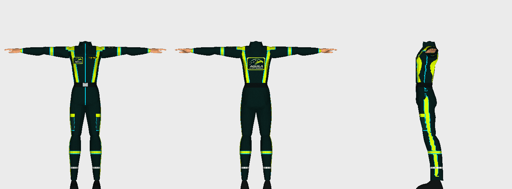
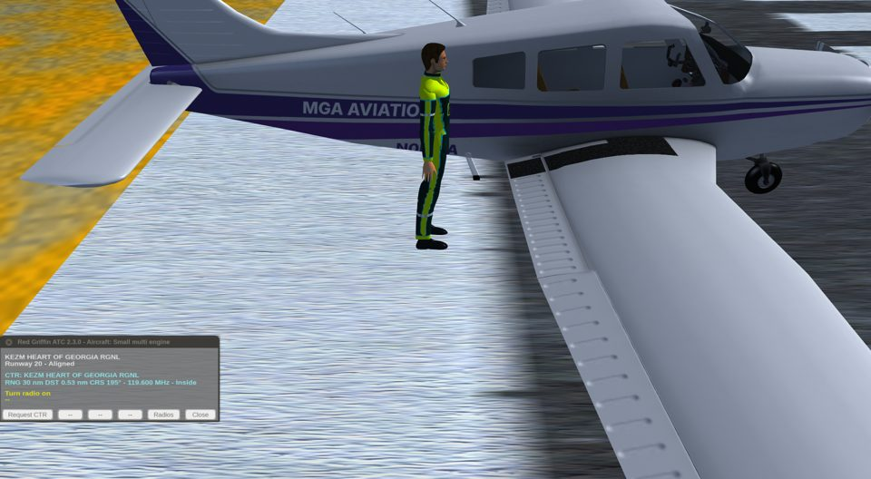
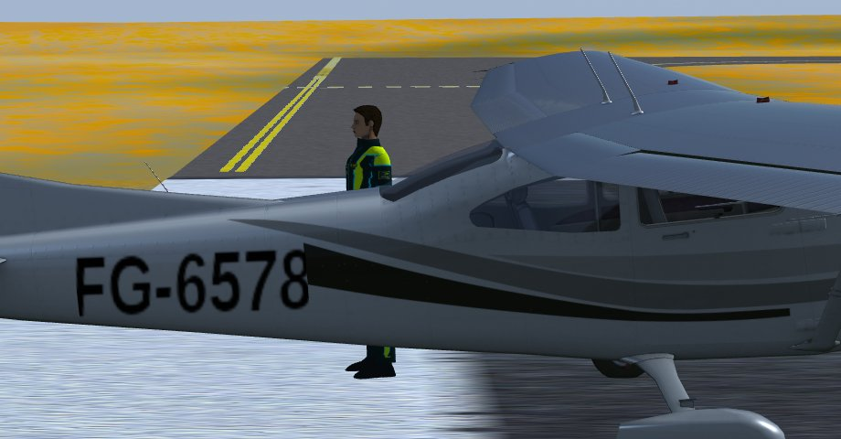
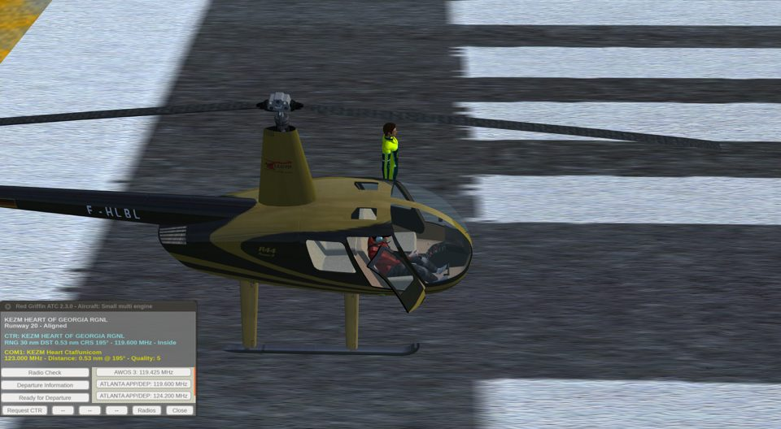

# Aquila walker

FlightGear's walker (the person you walk around the plane with, as in the 182S) in the
Aquila Flight Program flight suit, on every plane in the fgfs-mga fleet.

    bash install.sh            # install; safe to run again
    bash install.sh --dry-run  # what each plane would get
    bash install.sh --undo     # put everything back

In the sim: **Walker > Toggle Walker out/in**, then **View > Walker Orbit View** to see him
(or press `V` until it comes up). **Walk View** looks through his eyes, so he isn't visible there.
`w` walks, `W` runs, `s`/`S` back, `a`/`d` step sideways (in the walk views only).
**Walker > Select Theme > Waldo Aquila Flight Suit** brings the suit back if you pick another theme.

## The suit

One-piece suit from the Aquila Uniform Systems boards (v1.2 / v1.3): black-seafoam #0B2220 base,
acid-lime #DFFF00 shoulder caps and chest swooshes running from the shoulders in to the belt (front
and back), electric-cyan #00E5FF piping on the swooshes, shoulder seams and sides, a cyan front zip,
a dark belt with a silver buckle, lime outer-leg stripes, thigh cargo pockets with lime flaps, lime
bands below the knees, a segmented reflective ivory/silver band above the boots, lime arm caps,
armbands and cuffs, the Aquila patch on his right chest, pilot wings on his left chest, a small patch
on the left upper arm and a large Aquila patch on the back.

The walker model faces -x (FlightGear's forward), so "his right" is +y; v1 of the bake had the chest
patches and zip on the back by mistake.

It is a new texture on FlightGear's own flight-suit mesh (outfit 5, beside the stock outfits 0-4),
so it costs one 1024x1024 texture per gender and no extra geometry while the walker is hidden.
`src/bake.py` makes it: each texel of the mesh's UV layout is traced back to the 3D point it paints,
and the design is decided from that point (height, side, angle around the limb), so stripes and
panels line up across UV seams. `art/` holds the patch and wings cut from the board.
`src/render.py` draws front/back/side views of a bake (`previews/`).

## On each plane

`src/gen_walker.py` writes `aquila-walker.xml` next to the bottom file of each plane's include chain
and points that file's `<PropertyList include=...>` at it. It is FlightGear's
`Aircraft/Generic/Human/Include/walker-include.xml` with:

- the Aquila suit as the default outfit;
- an exit beside the plane's door (`exits.txt`);
- no walker key that the plane already binds itself. An include merges key bindings by index, so
  the stock include would put "only in Walk View" conditions on the plane's own keys (the Warrior's
  `j` tank switch and `D` autopilot disconnect, the Seneca's `d`/`D` doors, the Ag-Cat's and An-2's
  `s`). On the PA-18, whose `w` opens the window, the walker's `w` sits at binding 10 instead;
- `w`/`W` move the walker only in the walk views and still change the time warp elsewhere
  (the stock include took them over everywhere).

The 182S and PA-18 already carried the stock walker; they now get this one and keep their own exits.

Exits come from `src/exits.py`: it loads each plane's 3D model with its offsets, finds the ground
attitude (tail-down angle for taildraggers), and picks the nearest spot on the door side, at or aft
of the pilot's seat, where a person-sized column (0.32 m radius, 1.9 m tall) is clear of the
airframe. Planes sharing a base file share an exit (Warrior/Archer/Arrow, Seneca/Seminole).

One change to fgdata's `walk.nas`: the walker's momentum on stepping out now comes from groundspeed,
not airspeed. With airspeed, a parked plane in a 3 kt breeze threw him about 0.8 m ahead of the door.

## Checked (2026-11-26, ROCK 5B+, 2024.1.7 build, fgfs-mga fast preset, KEZM)

`src/walker_test.sh NAME`: ground start through fgfs-mga, walker sent out, outfit and position read
back over telnet, screenshots from the Walker Orbit View. Position is metres from the aircraft
reference point (x aft, y right).

| Plane | Outfit | Planned exit | Where he stood | Notes |
|---|---|---|---|---|
| Warrior | Aquila (5) | 0.70, 0.80 | 0.70, 0.80 |  9 fps with him out |
| 182S | Aquila (5) | 3.0, -1.5 (its own) | 2.98, -1.50 |  |
| AT-502B | Aquila (5) | 5.17, -0.80 | 4.99, -0.81 | under the low wing in the screenshots |
| R44 | Aquila (5) | -3.41, -1.70 | -3.41, -1.70 |  on the ground beside the left door (0.25 ft up) |
| Seneca II | Aquila (5) | 1.36, 0.95 | 1.36, 0.95 | Seneca's own sound-file error dialog covered the shots |
| An-2 | Aquila (5) | -1.17, -2.30 | -1.15, -2.30 | |
| Citabria | Aquila (5) | 3.56, 0.80 | 3.23, 0.78 | under the high wing in the screenshots |

Not started in the sim: Archer and Arrow (same file as the Warrior), Seminole (same file as the
Seneca), R22, Decathlon (same build as the Citabria), Zlin, 182RG, Skymaster, Dromader, Ag-Cat,
AT-802 (same build as the AT-502B). Their XML parses and their exits came from the same check.

**PA-18 does not load on the board**, with or without this change: it stops after the JSBSim
hydrodynamics file and never reaches the scenery (7.5 min, both runs). That is an older PA-18 problem.

`walk.nas` also prints "Error. Attempting to move to latitude ..." while scenery under the walker
is still loading; it comes from FlightGear's own walker code and stops once the tile is in.
